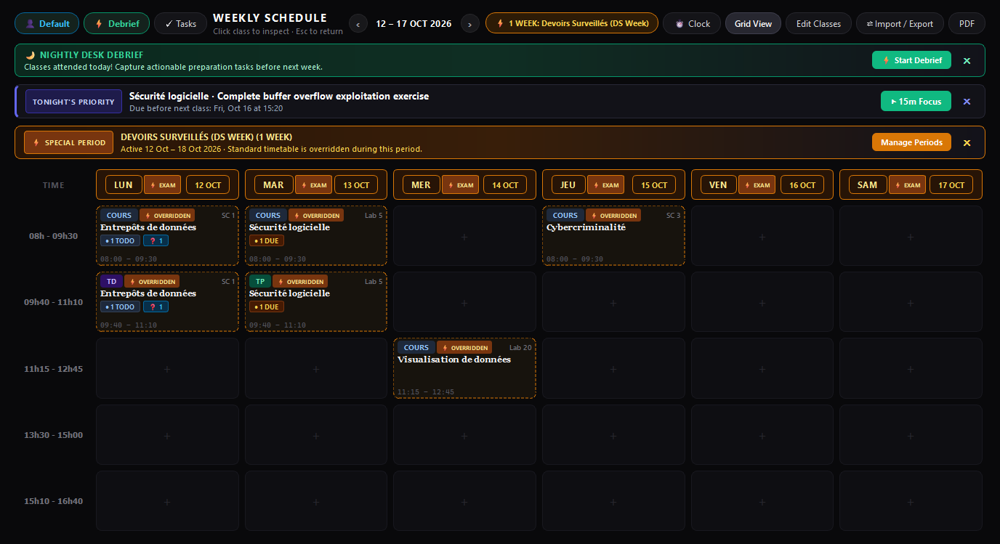
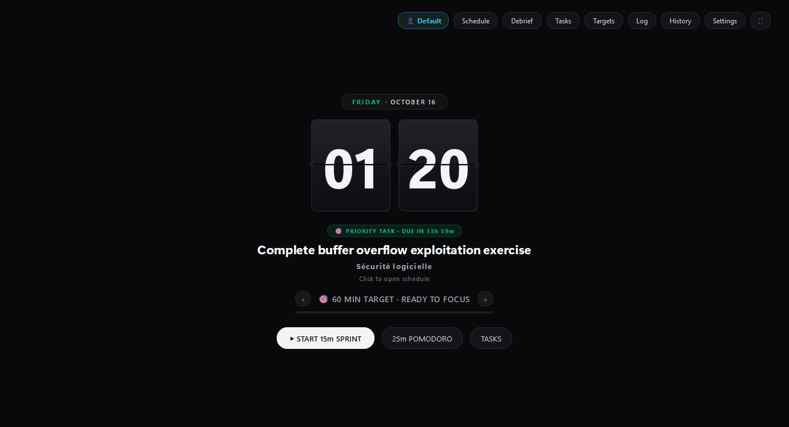
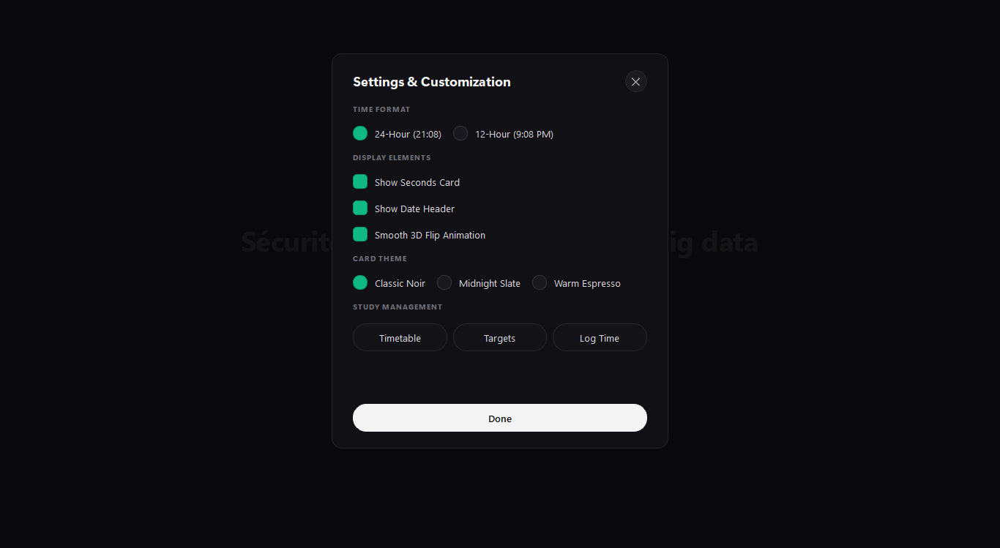
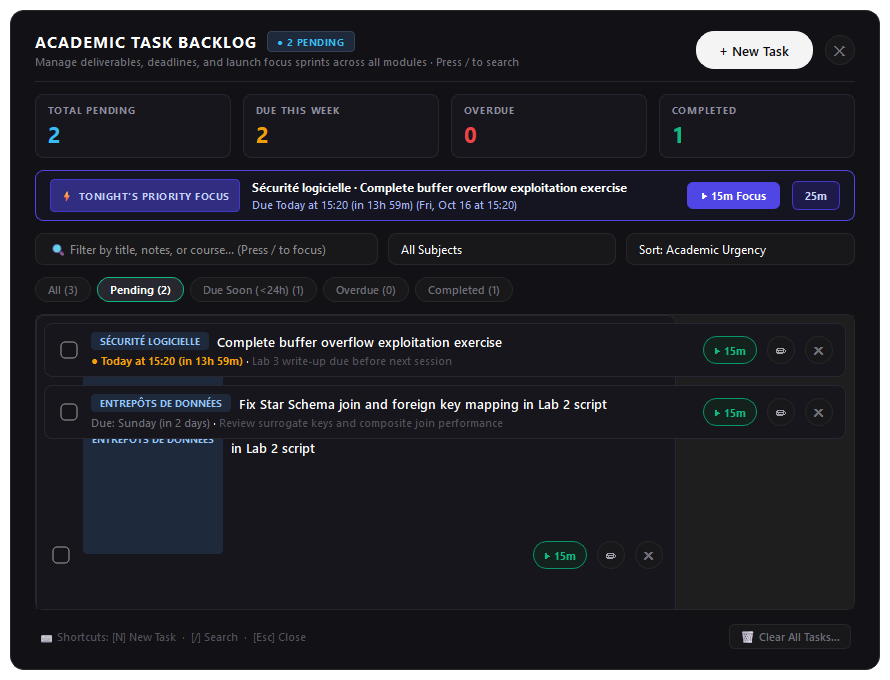
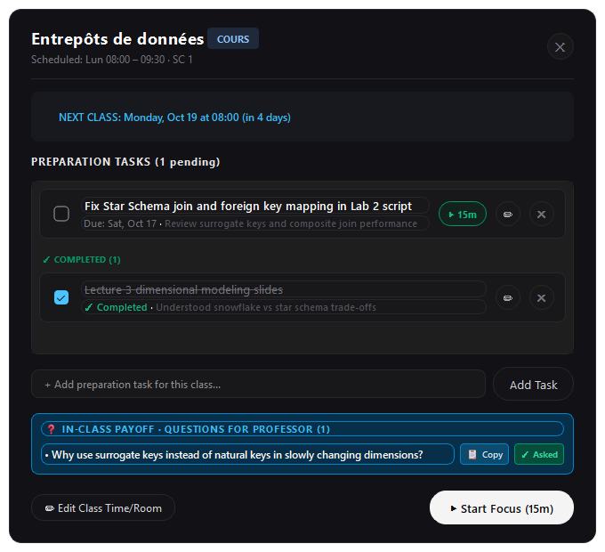
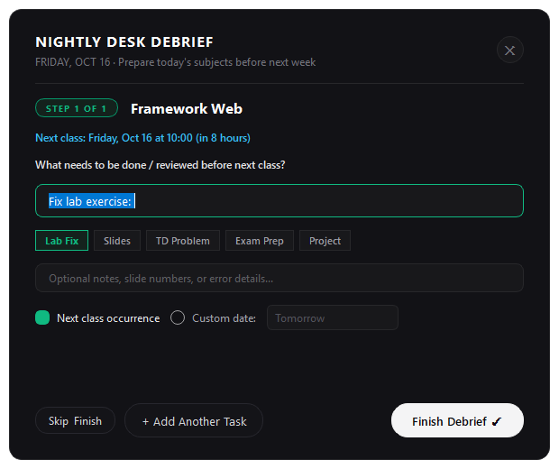
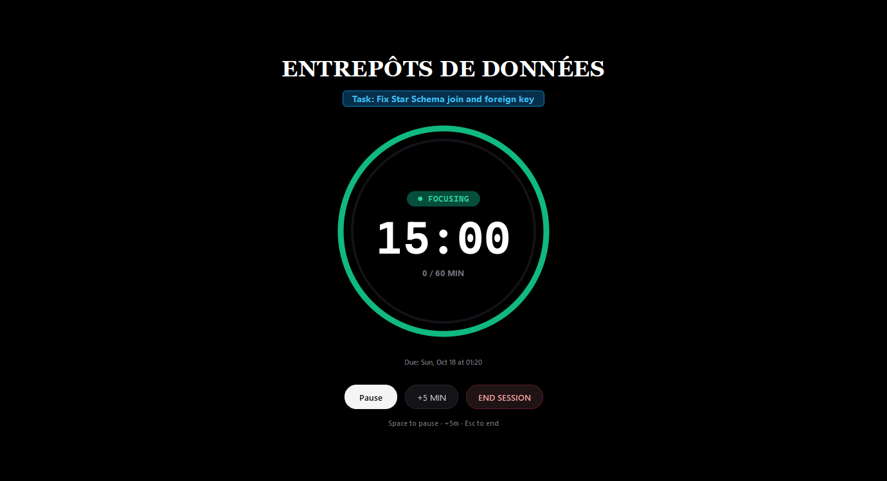
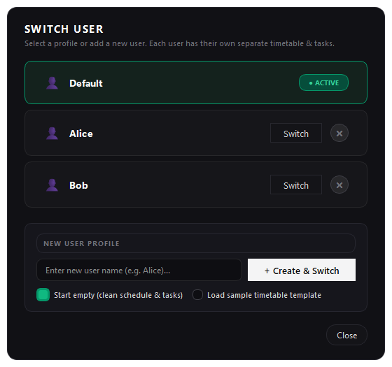
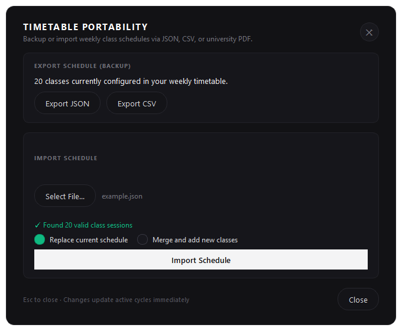

# Study Station

<div align="center">

### *A Schedule-Aware Academic Preparation Station & Focus Cockpit for University Students*

[](https://www.python.org/)
[](https://www.qt.io/)
[-003B57?style=flat&logo=sqlite&logoColor=white)](https://www.sqlite.org/)
[](#)
[-10B981?style=flat)](#test-suite--quality-assurance)
[](#)

</div>

---

## 1. Overview & Core Promise

**Study Station** turns any laptop, desktop PC, or secondary screen into an active, dedicated desk workstation for university students. 

Traditional productivity apps suffer from a fundamental mismatch with university life: they treat studying as a generic punch-clock timer or a static timetable viewer. Study Station solves the student's real dilemma:

> *"Today I had a difficult university class and I feel tired and demotivated to touch it again tonight. But I know with certainty that if I walk into next week's session without having reviewed the material, nothing will stick."*

Study Station bridges the gap between consecutive occurrences of the same subject. It combines an **interactive weekly academic cockpit**, an **automatic nightly debrief ritual**, an **active academic sprint launchpad**, **task-tethered micro-focus sprints**, **cognitive exit tickets** that formulate questions to ask professors in class, a **centralized task backlog with full CRUD**, and **zero-password multi-user profiles with database isolation**.

---

## 2. Visual Showcase

### The Academic Cockpit (Primary Station)
The weekly schedule grid acts as the student's default mission control, highlighting real calendar dates, live task badges, the Evening Desk Routine banner, Tonight's Priority Task capsule, and 1-click User Switch button (`[ 👤 Default ]`).



<br/>

### Core Workflow Interfaces

| Academic Sprint Launchpad (<kbd>C</kbd>) | Dynamic Theme & Customization (<kbd>⚙</kbd>) |
|:---:|:---:|
|  |  |
| *Mechanical flip clock displaying active pending task, deadline kicker, and 1-click sprint launchers.* | *Curated accents, canvas backgrounds, interactive color swatches, and live palette propagation.* |

| Academic Task Backlog (<kbd>T</kbd>) | Subject Preparation Sheet & In-Class HUD |
|:---:|:---:|
|  |  |
| *Macro backlog with live KPIs, multi-criteria filtering, in-place CRUD, and 1-click focus.* | *Preparation checklists with reversible check-offs, in-place edit/delete, & questions.* |

| Nightly Desk Debrief Modal | Task-Tethered Focus Gauge |
|:---:|:---:|
|  |  |
| *Multi-step evening ritual auto-calculating deadlines to next week's classes.* | *Distraction-free radial focus gauge with task title and deadline context.* |

| Multi-User Profile Switcher (<kbd>U</kbd>) | Timetable Portability (<kbd>I</kbd>) |
|:---:|:---:|
|  |  |
| *Zero-password kiosk user switching with isolated SQLite databases and instant seeding.* | *PDF schedule extraction, RFC 4180 CSV, and structured JSON import/export.* |

---

## 3. Product Philosophy & The Academic Pivot

Study Station was redesigned based on an exhaustive pedagogical audit ([`docs/ACADEMIC_PREPARATION_SPEC.md`](docs/ACADEMIC_PREPARATION_SPEC.md)) addressing the **5 core failure modes** of conventional study apps:

### 1. The "Monolith Trap": You Cannot Study a Noun
Students do not study *"Data Warehousing"* or *"Cybersecurity"*. They execute concrete, micro-scoped verbs: *"Fix Star Schema join in Lab 2"* or *"Review slide 14 on Kerberos tickets"*. Study Station tethers all focus sessions to concrete **`StudyTodo`** tasks.

### 2. "Imminent" vs. "Vulnerable" Suggestion Algorithms
Standard algorithms prompt you for tomorrow's classes. But university courses often occur once a week: if you attended a hard lecture today (e.g. Monday), the most vulnerable window for cognitive decay is **tonight**, not next Sunday evening. Study Station prioritizes material reviewed before it returns.

### 3. Eliminating Deficit Framing
Conventional apps display backlogs of "missed minutes", creating guilt and avoidance. In Study Station, there is no accumulating debt. Short 5, 10, or 15-minute micro-sprints count fully toward cycle targets.

### 4. "Factory Punch-Clock" vs. "Brain Comprehension"
Logging 45 minutes on a timer does not mean material was understood. The **Cognitive Exit Ticket** prompts the student immediately upon timer completion for:
- **Action**: Complete task, extend +10m continuation sprint, or put aside for later.
- **Traffic-Light Confidence**: 🔴 Foggy / Stuck, 🟡 Getting There, or 🟢 Solid.
- **Next-Class Question**: Formulate 1 question to ask the professor next week.
- **Feynman Takeaway**: 1-sentence synthesis saved to notes.

### 5. Breaking the Ambient Passivity Barrier
When arriving at the desk tired at night, looking at a passive clock or complex project board causes friction. Study Station engages **Evening Desk Mode** (after 18:00 local time), rendering:
- A high-contrast **Nightly Debrief Banner** if today's classes haven't been reviewed.
- A **Tonight's Priority Task Card** with an instant 1-click `[ ▶ 15m Focus ]` launcher.

---

## 4. Key Capabilities & Features

### 📅 Weekly Schedule Academic Cockpit (`ScheduleScreenWidget`)
- **Interactive University Grid**: Modeled directly after university timetables (`docs/grid.pdf`), mapping Monday through Saturday across standard university slots (`08:00–09:30`, `09:40–11:10`, `11:15–12:45`, `13:30–15:00`, `15:10–16:40`).
- **Date-Anchored Navigation**: Real calendar week navigation (`‹`, `›`, `Today`) with boundary-safe academic dates and emerald `TODAY` highlighting.
- **Live Dynamic Badges on Class Cards**:
  - `● X DUE` (amber/red): Pending tasks due before next session or overdue.
  - `● X TODO` (slate blue): Preparation tasks logged for this module.
  - `✓ READY` (emerald): All preparation tasks for this class are complete.
  - `❓ X` (sky blue): Formulated questions saved for this subject.
  - `❓ ASK IN CLASS (X)`: Glowing HUD badge when the class is in session right now (`● NOW`).

### ⚡ Nightly Desk Debrief Ritual (`DebriefDialog`)
- **Automated Check-In**: Triggered via top-bar button, banner, or global shortcut <kbd>D</kbd>. Auto-populates today's attended classes.
- **Cognitive Stepper**: Steps through subjects one by one to avoid fatigue.
- **Category Template Pills**: Instant prefixes (`💻 Lab Fix`, `📖 Slides`, `📝 TD Problem`, `🎯 Exam Prep`, `🚀 Project`).
- **Automatic Deadline Calculation**: Automatically resolves the start datetime of the next occurrence of that subject (`ScheduleEngine.get_next_class_deadline_for_subject`), with custom date override options.
- **Free Study Day Fallback**: Gracefully handles days with no classes by offering manual enrolled subject selection.

### 🎯 Subject Preparation Sheet (`SubjectPreparationSheet`)
- Click any class card on the grid to open its preparation drawer.
- Shows live relative countdown: `NEXT CLASS: Thursday at 08:00 (in 3 days)`.
- Interactive checklist of tasks with reversible check-offs, in-place `[ ✏ ]` edit, and `[ ✕ ]` delete.
- Quick inline task input bar with automatic next-class deadline calculation.
- **In-Class HUD Payoff**: Lists all questions formulated during nightly exit tickets with `[ 📋 Copy ]` to clipboard and `[ ✓ Asked ]` resolution buttons.

### 📋 Academic Task Backlog & Comprehensive CRUD (`TasksDialog` & `EditTodoDialog`)
- **Centralized Workstation Backlog**: Accessible via <kbd>T</kbd> or top-bar button `[ ✓ Tasks ]`. Inspect and manage all active and completed deliverables across all modules.
- **Telemetry KPI Summary Cards**: Real-time counters for `TOTAL PENDING`, `DUE THIS WEEK`, `OVERDUE`, and `COMPLETED`.
- **Multi-Criteria Filter Engine**: Instant live search, subject course dropdown, and status segmented pills (`All`, `Pending`, `Due Soon (<24h)`, `Overdue`, `Completed`).
- **Full Task Lifecycle & In-Place Editing**: Dedicated modal (`EditTodoDialog`) for updating titles, notes, subjects, and deadlines with smart presets (`Next Class`, `Tomorrow`, `+3 Days`, `+1 Wk`).
- **Reversible Check-offs & Safe Deletion**: Reopen completed tasks at any time; delete mistaken tasks with confirmation.
- **1-Click Task-Tethered Focus Sprint**: `[ ▶ 15m ]` button on any task row immediately launches the focused countdown gauge.

### ⏱ Task-Tethered Focus Gauge (`FocusWidget` 2.0)
- **Radial Ring Gauge**: Custom `QPainter` drawing elapsed/remaining progress arcs.
- **Task Header**: Slate cyan pill displaying active task title and relative deadline context (`Due: Thu, Oct 22 at 09:40`).
- **Micro-Sprint Durations**: Quick start presets for 5, 10, 15, or 25 minutes.
- **Session Controls**: Pause/Resume (<kbd>Space</kbd>), +5m extension (<kbd>+</kbd>), and End Session (<kbd>Esc</kbd>).

### 🎫 Cognitive Exit Ticket (`ExitTicketDialog`)
- Prompts immediately on focus timer completion.
- **Action Selection**: `[ ✓ Complete Task ]`, `[ +10m Need More Time ]` (seamless continuation sprint), or `[ ⏸ Put Aside for Later ]`.
- **Confidence Rating**: Traffic-light pill buttons (🔴 Foggy, 🟡 Getting There, 🟢 Solid).
- **Question Formulation**: Formulate questions to ask the professor; automatically pinned to the module's next class card.
- **Feynman Takeaway**: 1-sentence takeaway saved to task notes.

### ⇄ Timetable Portability (`ImportExportDialog` & `timetable_portability`)
- **University PDF Grid Extraction**: Direct extraction of sessions from university timetable PDFs (`docs/grid.pdf`) using `pypdf`.
- **Structured JSON & CSV Support**: RFC 4180 compliant CSV export/import (with UTF-8 BOM and automatic comma/semicolon detection) and structured JSON (`docs/example.json`).
- **Pre-Import Verification**: Conflict detection for overlapping slots with Replace vs. Merge strategies.

### 🚀 Academic Sprint Launchpad & Split-Flap Clock (`SubjectDashboardWidget` & `SplitFlapClockWidget`)
- **Mechanical Flip Clock Overhaul**: Realistic split-flap cards with horizontal crease, depth lighting, outer drum pins, clean sans-serif digits, and colon-free minimalist layout.
- **Active Task Sprint Launcher**: Rather than an isolated decorative clock, the screen functions as an active mission starting point displaying:
  - **Urgent Deadline Kicker Badge**: Relative countdown to next occurrence (e.g. `🎯 PRIORITY TASK · DUE IN 14h` or `⚠️ OVERDUE · WAS DUE 2h AGO`).
  - **Actionable Task Headline**: High-visibility 22px bold modern sans headline showing the exact task deliverable (e.g. `Complete buffer overflow exploitation exercise`).
  - **1-Click Sprint Buttons**: `[ ▶ START 15m SPRINT ]`, `[ 25m POMODORO ]`, and `[ TASKS ]` directly initiating micro-focus sessions tethered to that task.
  - **Cognitive Exit Ticket Tethering**: Session finish directly passes the active task to the Cognitive Exit Ticket for comprehension and question formulation.
- **Peaceful Ambient Auto-Hide**: Automatically hides navigation and sprint buttons after 3.5 seconds of inactivity, smoothly revealing controls on mouse movement.

### 🎨 Dynamic UI Customization System (`CustomizationDialog` & `AppSettings`)
- **Palette Presets & Custom Color Wheel**: Curated accent color swatches (Emerald, Electric Cyan, Violet, Amber, Coral, Minimal White) and deep canvas backgrounds (Midnight Noir, Deep Slate, Espresso, Void Black).
- **Custom Color Picker**: Native `QColorDialog` for selecting any hex color code.
- **Real-Time Live Propagation**: Color choices instantly update the canvas, split-flap cards, hero banners, progress bars, and schedule views with SQLite persistence.
- **Full-Height Session Manager**: Clean tabular schedule editor with 100% vertical space dedicated to academic sessions, free of inline clutter.

### 👤 Zero-Password Multi-User Profiles & Database Isolation (`UserManager` & `UserSwitchDialog`)
- **Shared Desk Appliance Experience**: Designed for kiosk setups where multiple students share the workstation. Zero password prompts or login friction.
- **True Database Isolation**: Each student gets an independent SQLite database (`%APPDATA%/study_station/users/{username}.db`) storing their own timetable, deliverables, target minutes, and study history.
- **1-Click Switching**: Click `[ 👤 {Username} ]` in the top header or press <kbd>U</kbd> to open the switcher modal and pick a profile or create a new user.
- **Clean Slate (Empty Schedule & Tasks) as Default**: Newly created user profiles start with a clean slate (0 scheduled classes, 0 pending tasks) so students can build their own schedule from scratch or import their own files.
- **Template Choice Option**: The creation dialog offers an explicit option to "Start empty (clean schedule & tasks)" or "Load sample timetable template".
- **On-Demand "Empty Schedule" & "Empty Tasks"**:
  - `[ 🗑 Empty Schedule ]` button in the Weekly Schedule Editor toolbar clears all scheduled sessions with student confirmation.
  - `[ Empty Tasks ]` button in the Academic Tasks modal header clears all tasks with student confirmation.
- **Zero-Restart Seamless Live Switch**: Instantly pauses any active timer, safely switches SQLite database connections, reloads the engine and UI themes, and refreshes the cockpit without restarting the app.

### 🛡 Local Persistence & Hardware Resilience (`StudyStationRepository`)
- **SQLite Database with WAL Mode**: Fast local storage in `%APPDATA%/StudyStation/` (Windows) or `~/.local/share/study_station/` (Linux).
- **Crash & Sleep Recovery**: Active timer states are persisted periodically. If the computer goes to sleep or restarts, the session resumes seamlessly or attributes the full completed duration upon waking.
- **Calm Acoustic Feedback**: Synthesized acoustic chime (harmonic bell envelope) upon focus completion.

---

## 5. Technical Architecture & Stack

```
study-station/
├── docs/                                  # Specifications, concepts, and design docs
│   ├── ACADEMIC_PREPARATION_SPEC.md       # Full 5-milestone academic preparation architecture
│   ├── grid.pdf                           # Original university timetable PDF
│   ├── example.json                       # Sample JSON timetable schema
│   └── screens/                           # High-resolution documentation screenshots
├── scripts/
│   └── capture_screens.py                 # Automated headless screenshot generator
├── src/
│   └── study_station/
│       ├── core/                          # Domain logic, models, and calculation engine
│       │   ├── models.py                  # Dataclasses: StudyTodo, AcademicSession, StudyCycle, etc.
│       │   ├── engine.py                  # ScheduleEngine: timetable resolution, debrief logic, todos
│       │   ├── timer.py                   # FocusTimer: timestamp-based countdown with sleep recovery
│       │   ├── timetable_portability.py   # PDF extraction, JSON/CSV import & export, collision detection
│       │   └── sound_manager.py           # Calibrated acoustic harmonic completion chime
│       ├── persistence/                   # Local database and repository layer
│       │   ├── database.py                # SQLite connection manager with WAL & automatic migrations
│       │   ├── repository.py              # CRUD repository for logs, timetable, todos, and settings
│       │   └── user_manager.py            # Multi-user profile configuration and path isolation
│       └── ui/                            # PySide6 Qt Widgets presentation layer
│           ├── main_window.py             # Root window with screen stack and global shortcut dispatch
│           ├── schedule_screen_widget.py  # Weekly Schedule Cockpit, banners, class cards, editor
│           ├── subject_preparation_sheet.py # Subject tasks checklist drawer & in-class question HUD
│           ├── debrief_dialog.py          # Nightly Desk Debrief multi-step questionnaire
│           ├── exit_ticket_dialog.py      # Cognitive Exit Ticket dialog (confidence & questions)
│           ├── focus_widget.py            # Task-tethered radial focus gauge screen
│           ├── completion_widget.py       # Focus celebration & confidence feedback screen
│           ├── dashboard_widget.py        # Ambient split-flap clock screensaver view
│           ├── flip_clock.py              # Custom QPainter 3D split-flap flip card widget
│           ├── import_export_dialog.py    # Timetable import/export modal with live preview
│           ├── tasks_dialog.py            # Academic task backlog modal with multi-criteria filters
│           ├── user_switch_dialog.py      # Kiosk multi-user profile switcher modal
│           └── theme.py                   # Centralized dark palette, typography, and button styles
├── tests/                                 # Complete unit test suite (18 test modules)
│   ├── test_multi_user.py                 # Milestone 17: User manager, database isolation, switch modal
│   ├── test_night_routine_hud.py          # Milestone 14: Evening desk mode, hero tasks, question HUD
│   ├── test_exit_ticket.py                # Milestone 13: Exit ticket actions, confidence, continuation
│   ├── test_grid_main_screen.py           # Milestone 12: Grid cockpit, preparation badges, sheet drawer
│   ├── test_debrief_dialog.py             # Milestone 11: Debrief wizard, auto-deadlines, template pills
│   ├── test_todo_engine.py                # Milestone 10: StudyTodo CRUD, migrations, queries
│   ├── test_timetable_portability.py      # Milestone 9: PDF extraction, CSV/JSON round-trips
│   └── ...                                # Milestones 1–8: Engine, timer, persistence, sound, etc.
└── requirements.txt                       # Project dependencies
```

---

## 6. Installation & Quick Start

### Prerequisites
- **Python 3.10+**
- **Operating System**: Linux (Fedora, Ubuntu, Debian with X11 / Xfce / GNOME) or Windows 10/11.

### 1. Clone the Repository
```bash
git clone https://github.com/your-username/study-station.git
cd study-station
```

### 2. Set Up Virtual Environment
```bash
# Linux / macOS
python3 -m venv .venv
source .venv/bin/activate

# Windows (PowerShell)
python -m venv .venv
.venv\Scripts\Activate.ps1
```

### 3. Install Dependencies
```bash
pip install -r requirements.txt
```

### 4. Run Study Station
```bash
# Linux / macOS
PYTHONPATH=src python3 -m study_station.main

# Windows (PowerShell)
$env:PYTHONPATH="src"; python -m study_station.main
```

---

## 7. Keyboard Shortcuts Reference

Study Station is designed for rapid, keyboard-first workstation operation:

| Shortcut | Context | Action |
|:---:|:---:|:---|
| <kbd>D</kbd> | Cockpit Grid / Clock | Open **Nightly Desk Debrief** questionnaire dialog |
| <kbd>C</kbd> or <kbd>A</kbd> | Cockpit Grid | Switch to **⏱ Ambient Clock Station** screensaver |
| <kbd>G</kbd> or <kbd>Esc</kbd> | Ambient Clock | Return to **Weekly Schedule Academic Cockpit** |
| <kbd>Space</kbd> / <kbd>Return</kbd> | Cockpit Grid / Clock | Start default focus session (15 min) |
| <kbd>1</kbd> / <kbd>2</kbd> / <kbd>3</kbd> / <kbd>4</kbd> | Cockpit Grid / Clock | Start micro-focus session for **5**, **10**, **15**, or **25** min |
| <kbd>I</kbd> | Cockpit Grid / Clock | Open **Timetable Import / Export** dialog |
| <kbd>E</kbd> | Cockpit Grid / Clock | Open **Timetable Editor** table |
| <kbd>S</kbd> | Cockpit Grid / Clock | Open **Review Targets** configuration dialog |
| <kbd>M</kbd> | Cockpit Grid / Clock | Open **Manual Offline Study Time** logger |
| <kbd>H</kbd> | Cockpit Grid / Clock | Open **Study History & Logs** viewer |
| <kbd>T</kbd> | Cockpit Grid / Clock | Open **Academic Task Backlog** dialog |
| <kbd>F11</kbd> | Any Screen | Toggle **Fullscreen Mode** |
| <kbd>Space</kbd> | Focus Screen | **Pause / Resume** active countdown |
| <kbd>+</kbd> or <kbd>=</kbd> or <kbd>5</kbd> | Focus Screen | **Add +5 Minutes** to active session |
| <kbd>Esc</kbd> or <kbd>Return</kbd> | Focus Screen | **Finish Focus Session** (opens Exit Ticket) |
| <kbd>Q</kbd> | Any Screen (Idle) | Cleanly quit Study Station |

---

## 8. Test Suite & Quality Assurance

Study Station is backed by a deterministic, zero-external-dependency test suite running on `unittest`:

```bash
# Run all 129 unit tests across all 18 test suites
$env:PYTHONPATH="src"; python -m unittest discover tests
```

### Test Coverage Highlights
- **Engine & Scheduling**: 100% boundary safety on academic week transitions, timezone-free calendar arithmetic, and collision detection.
- **Persistence & Migrations**: SQLite schema migrations, foreign keys, and sleep/crash recovery verification.
- **Portability**: PDF grid extraction, CSV parsing with French semicolons and UTF-8 BOM, and JSON round-trips.
- **Interactive UI**: Headless verification of `ScheduleScreenWidget`, `SubjectDashboardWidget`, `SplitFlapClockWidget`, `DebriefDialog`, `ExitTicketDialog`, `SubjectPreparationSheet`, `TasksDialog`, and `FocusWidget`.

```
.............................................................................................................................................
----------------------------------------------------------------------
Ran 141 tests in 15.540s

OK (100% passing across 19 test suites)
```

---

## 9. Automated Screenshot Generation

You can programmatically re-generate all high-resolution documentation screenshots across various application states at any time:

```bash
$env:PYTHONPATH="src"; python scripts/capture_screens.py
```
This script renders and grabs:
- `docs/screens/grid_schedule.png` (Academic Cockpit Grid with Special Period Overrides)
- `docs/screens/edit_schedule.png` (Full-height class session table)
- `docs/screens/clock_no_hover.png` (Ambient sprint launchpad in idle mode)
- `docs/screens/clock_with_hover.png` (Sprint launchpad with active launchers)
- `docs/screens/focus.png` (Radial focus gauge tethered to task)
- `docs/screens/add_class.png` (Session creation modal with conflict resolution)
- `docs/screens/preparation_sheet.png` (Subject tasks checklist drawer & in-class HUD)
- `docs/screens/debrief_modal.png` (Nightly desk debrief wizard with active template highlights)
- `docs/screens/import_export.png` (Timetable import/export modal)
- `docs/screens/tasks_modal.png` (Academic task backlog with multi-criteria sorting)
- `docs/screens/settings.png` (Theme customization palette & swatches)
- `docs/screens/exit_ticket.png` (Cognitive exit ticket & question formulation)
- `docs/screens/switch_user_modal.png` (Kiosk multi-user profile switcher dialog)
- `docs/screens/special_periods.png` (Academic Period Overrides manager: Day, Days, Weeks)

---

## 10. Milestone Implementation Roadmap

*See [`docs/ROADMAP_TIERS.md`](docs/ROADMAP_TIERS.md) for the detailed 3-tier architectural roadmap.*

| Milestone | Title | Focus Area | Status |
|:---:|:---|:---|:---:|
| **1** | Project Foundation | Window lifecycle, fullscreen, Linux X11/Xfce support | `[COMPLETED]` |
| **2** | Ambient Flip Clock | Custom QPainter flip cards, time formatting, ScheduleEngine | `[COMPLETED]` |
| **2.5** | Modern UI & Calm Discipline | 3D folding animations, auto-hiding action bars, typography | `[COMPLETED]` |
| **3** | Focus Timer & Completion | Focus timer engine, micro-durations, celebration feedback | `[COMPLETED]` |
| **4** | Persistence & Recovery | SQLite WAL database, crash/sleep state recovery | `[COMPLETED]` |
| **5** | Secondary Management UI | Timetable editor, review targets, offline manual logger | `[COMPLETED]` |
| **6** | Academic Week Anchoring | Real calendar dates, week navigation (`‹`, `›`, `Today`) | `[COMPLETED]` |
| **7** | Study Logs & History | Full session log viewer, filtering, summary stats | `[COMPLETED]` |
| **8** | Calibrated Sound Manager | Synthesized acoustic harmonic completion chime | `[COMPLETED]` |
| **9** | Timetable Portability | University PDF parsing, RFC 4180 CSV, JSON import/export | `[COMPLETED]` |
| **10** | Academic Todo Engine | `StudyTodo` dataclass, SQLite schema, migrations, `todo_id` | `[COMPLETED]` |
| **11** | Nightly Desk Debrief | Multi-step questionnaire wizard, auto-deadlines, template pills | `[COMPLETED]` |
| **12** | Academic Cockpit Grid | Grid as main station, live preparation badges, task drawer sheet | `[COMPLETED]` |
| **13** | Todo-Driven Focus Loop | Task framing on focus ring, 🔴🟡🟢 exit ticket, Feynman notes | `[COMPLETED]` |
| **14** | Night Routine Ambient UX | Evening desk mode, Tonight's Priority Task capsule, in-class HUD | `[COMPLETED]` |
| **15** | Academic Task Backlog & CRUD | Central backlog (<kbd>T</kbd>), EditTodoDialog, reversible check-offs, in-place edit/delete | `[COMPLETED]` |
| **15.5** | Runtime Stability & Backlog Polish | Signal lifecycle stability, font evaluation, upcoming class calculations | `[COMPLETED]` |
| **16** | UI Professionalization & Sprint Launchpad | Split-flap mechanical clock, dynamic customization engine, active task sprint launcher | `[COMPLETED]` |
| **17** | Multi-User Profiles & DB Isolation | Zero-password user switching, isolated SQLite databases, instant seeding, and top-bar button | `[COMPLETED]` |
| **18** | Immediate UX Polish & Anti-Fatigue Workflows | Top-bar clustering, adaptive exit ticket, priority dismiss, positive clock framing | `[COMPLETED]` |
| **19** | Urgency Engine & Period Overrides | Tomorrow-morning proximity bias, backlog sorting, safe purge, and Special Academic Overrides (day/x days/weeks/x weeks) | `[COMPLETED]` |

---

## 11. License

Study Station is open-source software built for students. Released under the [MIT License](LICENSE).
